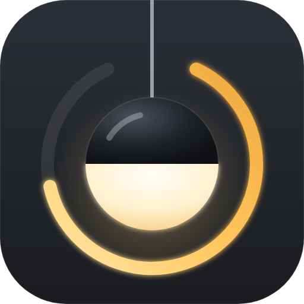

# Flos String Light for Home Assistant

A Home Assistant integration for the **Flos String Light**, over Bluetooth Low Energy. Each lamp shows up as a dimmable light (on, off, brightness) and talks to Home Assistant through Home Assistant's own Bluetooth: the adapter in the host or an ESPHome Bluetooth proxy.

> **Status: working, still young.** Home Assistant finds the lamps, keeps a connection to each one and switches and dims them. So far it runs on the author's lamps through an ESPHome Bluetooth proxy; the host's own adapter is untested. Reports from other owners are welcome in [Issues](https://github.com/g-force-be/ha-flos-string-light/issues).

## Installation

**HACS**

1. HACS → ⋮ → *Custom repositories* → add `https://github.com/g-force-be/ha-flos-string-light`, type *Integration*.
2. Download **Flos String Light** and restart Home Assistant.

**By hand:** copy `custom_components/flos_string` to `config/custom_components/` and restart Home Assistant.

You need:

- Home Assistant 2026.3 or later (tested on 2026.10.4).
- The **Bluetooth** integration with an adapter that can connect: the host's own adapter or an ESPHome Bluetooth proxy. Shelly devices only pass on advertisements; they can't connect to the lamp.

## Configuration

**Automatically.** Home Assistant recognises a lamp by the Bluetooth service it advertises (`0dcecf0c-ad06-11e3-81e4-425861b86ab6`) and offers it under *Settings → Devices & services → Discovered*. Confirm it and give it a name if you like.

**By hand.** *Settings → Devices & services → Add integration → Flos String Light*, then enter the lamp's Bluetooth address (`XX:XX:XX:XX:XX:XX`) and a name.

## How it works

- One light entity per lamp. Home Assistant's brightness (0–255) maps to the lamp's 0–100; 0 is off. *Turn on* without a brightness brings back the last one (100 % the first time).
- The brightness is one byte on characteristic `335c1504-ad06-11e3-81e4-425861b86ab6` of service `0dcecf0c-ad06-11e3-81e4-425861b86ab6`.
- **One connection per lamp, kept open.** The integration connects when Home Assistant starts and stays connected. Starting never waits for a lamp: the connection is made in the background.
- **The first connection is made twice.** On the connection that looks up the lamp's services, the first one after Home Assistant starts, the lamp accepts a brightness and reads it back but doesn't carry it out. The integration closes its first connection straight away and opens a second, which the lamp does obey. Seen through an ESPHome Bluetooth proxy. It costs a few seconds at start, and again when the entry is reloaded.
- **The lamp reports its own level.** After every connection the integration subscribes to the lamp's indications on the brightness characteristic, and those are the state. Nothing is polled.
- **Safety net.** Every 5 minutes the brightness is read over the open connection, in case an indication never came. After a command the level is read back straight away, because the lamp sends no indication for a change it was told to make.
- **Available means connected.** When the connection drops, the entities turn *unavailable* at once. The integration reconnects after 5, 10 and 30 seconds and then every minute, and sooner when the lamp is seen advertising again.

What the open connection costs:

- **One connection slot per lamp, permanently.** An ESPHome Bluetooth proxy has three by default, so one proxy carries three lamps and nothing else that needs a connection.
- **The Flos app cannot connect while Home Assistant is connected.** The lamp accepts one connection at a time. Disable the lamp's entry in Home Assistant for as long as you want to use the app.

## The lamp's name

Each lamp also has a text entity **Name**, under *Configuration* on the device page. It shows the name stored in the lamp, the one it advertises over Bluetooth, and lets you change it.

- The lamp stores 18 bytes of UTF-8. Bytes are counted, not characters: an accented letter takes two or more. A name that doesn't fit is refused.
- Changing it renames the lamp itself. The device and entity names in Home Assistant stay as they are.
- The name is written to the lamp's own name characteristic (`5be8ef0a-b3d3-11e3-8ed5-425861b86ab6`); the lamp copies it to the standard Bluetooth Device Name, which is where it is read. Windows and iOS keep that standard characteristic to themselves, so a generic Bluetooth tool there can't read or change the name. Linux does the same on the host's own adapter: there the entity can stay *unknown*, while writing still works.

## Limitations

- Brightness and the name only.
- One permanent connection slot per lamp, and no Flos app while Home Assistant is connected (see above).

## Known issues

- **Invisible character in an old entry's title.** A lamp added with an earlier version can have a title that ends in a NUL character from its Bluetooth name. The device name is cleaned up; rename the entry if the title bothers you. New entries don't get it.

## Debug logging

*Settings → Devices & services → Flos String Light → ⋮ → Enable debug logging*, or in `configuration.yaml`:

```yaml
logger:
  logs:
    custom_components.flos_string: debug
```

The log then shows each connection and disconnection, every indication, read and write, and once per start the lamp's full GATT table.

## Releases and versions

Versions follow the calendar: **year.week.number**, e.g. `2026.45.1` is the first release in ISO week 45 of 2026, and `2026.45.2` the second. A release is made from the Actions tab (*Release → Run workflow*). It writes the version into `manifest.json`, tags that commit and publishes a GitHub release, which HACS then offers as an update.

## Development

```sh
python -m compileall -q custom_components   # does the Python compile
python tools/brand.py                       # brand icons from docs/images/icon.svg (needs Pillow and Chrome)
```

The *Validate* workflow runs HACS's check and Home Assistant's `hassfest` on every push to `main`.

## Disclaimer

Not affiliated with or endorsed by Flos. Flos is a trademark of Flos S.p.A. This project contains no Flos logo, wordmark or product photography; the icon is original artwork.

## Licence

MIT, see [`LICENSE`](LICENSE).
